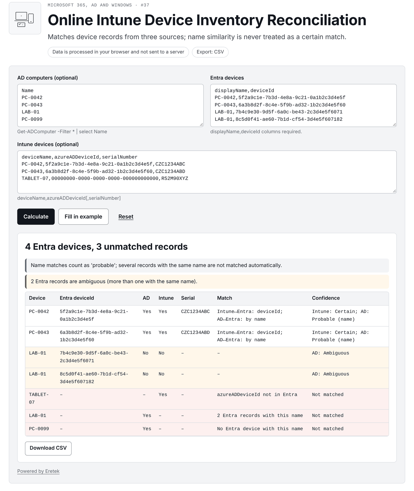

# Intune Device Inventory Reconciliation

Match AD computer, Microsoft Entra device and Intune lists by deviceId and name; certain, probable and ambiguous matches and missing records are separated.

## Try it live

- [Türkçe](https://sistem.eretek.com/araclar/intune-cihaz-envanteri-karsilastirma)
- [English](https://sistem.eretek.com/en/tools/intune-device-inventory-reconciliation)
- [Deutsch](https://sistem.eretek.com/de/werkzeuge/intune-geraeteinventar-abgleich)



## What it does

Matches device records from three sources; name similarity is never treated as a certain match.

A device has separate records in AD, Entra and Intune, and they drift: a reimaged computer leaves two records in Entra, a device deleted from Intune stays in Entra. Matching by name gives wrong results in these cases. The tool matches Intune ↔ Entra exactly by `azureADDeviceId`; AD ↔ Entra by name is marked 'probable', and several Entra records with the same name are 'ambiguous'.

## Where it helps

Ambiguous records and records in one source only are clean-up candidates; check last activity first. For hybrid devices check the device state with the dsregcmd Output Analyzer.

## How to use it

1. Paste the Entra device list with `displayName,deviceId`, the Intune list with `deviceName,azureADDeviceId,serialNumber` and the AD list with `Name` as CSV.
2. Press Calculate; download the table as CSV.

### Fields

| Field | Description |
|---|---|
| AD computers (optional) | Get-ADComputer -Filter * \| select Name |
| Entra devices | displayName,deviceId columns required. |
| Intune devices (optional) | deviceName,azureADDeviceId[,serialNumber] |

## Example input

Press **Fill in example** in the tool to load this input.

**AD computers (optional)**

```text
Name
PC-0042
PC-0043
LAB-01
PC-0099
```

**Entra devices**

```text
displayName,deviceId
PC-0042,5f2a9c1e-7b3d-4e8a-9c21-0a1b2c3d4e5f
PC-0043,6a3b8d2f-8c4e-5f9b-ad32-1b2c3d4e5f60
LAB-01,7b4c9e30-9d5f-6a0c-be43-2c3d4e5f6071
LAB-01,8c5d0f41-ae60-7b1d-cf54-3d4e5f607182
```

**Intune devices (optional)**

```text
deviceName,azureADDeviceId,serialNumber
PC-0042,5f2a9c1e-7b3d-4e8a-9c21-0a1b2c3d4e5f,CZC1234ABC
PC-0043,6a3b8d2f-8c4e-5f9b-ad32-1b2c3d4e5f60,CZC1234ABD
TABLET-07,00000000-0000-0000-0000-000000000000,R52M90XYZ
```

**Expected result:** PC-0042 and PC-0043 in all three sources (Intune certain, AD probable); LAB-01 has two Entra records → ambiguous; TABLET-07 is in Intune but its Entra ID does not match; PC-0099 only in AD.

## Method and assumptions

An Intune row matches exactly if its azureADDeviceId equals an Entra deviceId (case-insensitive).

An AD row is probable if the first label of its name matches one Entra record; with several Entra records of that name it is ambiguous and not matched automatically.

## Limits and common mistakes

- Matching Entra onPremisesSecurityIdentifier to AD SIDs is not done in this version.
- Last activity dates are not evaluated.

## Run it locally

The tool is plain HTML, CSS and JavaScript with no build step and no dependencies.

```bash
git clone https://github.com/eretek/intune-device-inventory-reconciliation.git
cd intune-device-inventory-reconciliation
node scripts/serve.js        # or: python3 -m http.server 8080
```

Open <http://127.0.0.1:8080/>. Add `?lang=tr` or `?lang=de` for Turkish or German; without it the page follows the browser language and falls back to English. You can also open `index.html` directly from disk.

Run the tests (Node.js 18 or later):

```bash
node test/run.js    # or: npm test
```

The tests run the tool's own fixtures and the worked examples in all three languages without a browser.

## How it works

All processing happens in your browser. The tool makes no network requests, uses no cookies or browser storage, and does not upload files you select.

No server-side component is needed. The version on the Eretek website renders the same page through a private WordPress plugin; that plugin only produces the page markup and is not part of this repository.

| Path | Purpose |
|---|---|
| `index.html` | Page shell |
| `src/app.js` | Builds the page in Turkish, English or German from `src/data.js` |
| `src/data.js` | Field definitions, examples and all texts in three languages |
| `src/core.js` | Shared runtime: validation, number formats, result rendering, CSV/ICS export |
| `src/tool.js` | The calculation or analysis for this tool |
| `docs/screenshot.png` | Screenshot used in this README |
| `src/tools.css`, `src/page.css` | Styles |
| `test/run.js`, `test/cases.json` | Headless tests |

## License and attribution

This tool is released under the [Eretek Website Attribution License](LICENSE). You may use, modify and redistribute it, including commercially. If you make it available on a website or web application, show a visible, clickable credit linking to https://eretek.com/ on every page where the tool is available, for example:

```html
<a href="https://eretek.com/">Powered by Eretek</a>
```

You may add `rel="nofollow"` to the link. Keep the copyright notice and license text in copies and redistributions.
